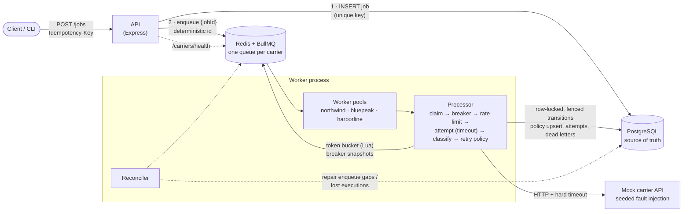
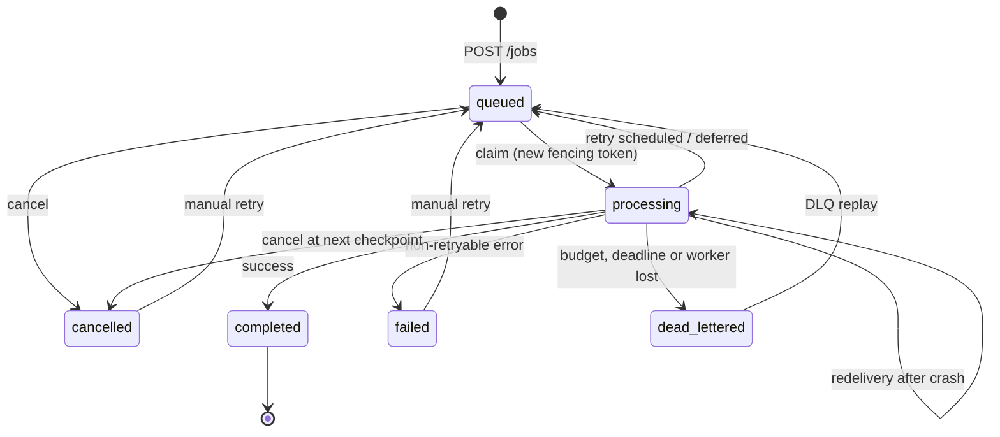

# CarrierChaos

**A third-party integration reliability engine: retrieving insurance policy data correctly when carrier APIs are slow, rate-limited, flaky, down, or wrong.**

[](https://github.com/TylerOnTech/CarrierChaos/actions/workflows/ci.yml)

CarrierChaos runs many concurrent policy-retrieval jobs against simulated insurance carriers
that fail in realistic, reproducible ways, and shows the infrastructure responding: bounded
retries with backoff, honoring `Retry-After`, circuit breaking, per-carrier rate limits, hard
timeouts, dead-lettering with controlled replay, and idempotent effects under at-least-once
delivery. Every claim is backed by a test or a measured experiment.

> **The question this project answers:** how do we reliably retrieve insurance data when
> upstream services are slow, rate-limited, intermittently unavailable, or returning invalid
> responses?

TypeScript (strict) · Node.js 22 · Express 5 · BullMQ on Redis · PostgreSQL via Prisma 7 · Zod · Pino · Prometheus · Vitest + Supertest · Docker Compose · GitHub Actions

---

## Contents

- [Highlights](#highlights)
- [Architecture](#architecture)
- [Job state machine](#job-state-machine)
- [Resilience mechanisms](#resilience-mechanisms)
- [Delivery guarantees](#delivery-guarantees)
- [Quick start](#quick-start)
- [API](#api)
- [Experiments and results](#experiments-and-results)
- [Load test](#load-test)
- [Tests and CI](#tests-and-ci)
- [Design tradeoffs](#design-tradeoffs)
- [Repository layout](#repository-layout)
- [Reuse in CarrierBridge](#reuse-in-carrierbridge)
- [Limitations](#limitations)

## Highlights

- **Fault-injecting mock carrier.** 429, 500, 503, slow responses, hanging requests, connections
  cut mid-body, invalid JSON, contract-violating JSON and expired sessions, chosen per request
  by probability or by an explicit sequence. Faults are seeded per *(policy, attempt)*, so an
  experiment reproduces exactly no matter how workers interleave.
- **Queue-per-carrier bulkheads.** Each carrier has its own BullMQ queue, worker pool, circuit
  breaker and Redis token bucket. A hanging carrier cannot starve a healthy one.
- **Correct state machine.** PostgreSQL is the source of truth. Every transition is a short
  row-locked transaction, and worker writes are fenced by an execution token, so a zombie worker
  can never record a second result.
- **Idempotency end to end.** A required `Idempotency-Key` with a payload fingerprint, a unique
  job per key (even under 25 concurrent duplicates), a policy upsert per (carrier, policy), and
  at most one successful completion per run.
- **Dead letters you can work with.** Inspectable reasons and attempt history, and an admin-only
  replay that starts a new run with a fresh budget.
- **Measured, not claimed.** Experiments A-D and a load test record what actually happened,
  cross-checked against the mock carrier's own request counters.

## Architecture



**Lifecycle of a job**

1. `POST /jobs` validates the request, fingerprints the payload, and inserts a `queued` job. The
   idempotency key is a unique column, so concurrent duplicates collapse to one row.
2. After commit, the API enqueues `{ jobId }` on the carrier's queue under a deterministic BullMQ
   id, which makes enqueueing idempotent.
3. A worker **claims** the job: under a row lock it moves the job to `processing` and writes a
   fresh `execution_id` (the fencing token).
4. **Circuit breaker:** if the carrier's breaker is open, the job is deferred without spending an
   attempt.
5. **Rate limiter:** a shared Redis token bucket. Short waits happen in-process; longer ones defer
   the job and free the worker slot.
6. **Attempt:** an HTTP call (token refresh included) under a hard timeout. The response is
   parsed and validated against [NormalizedPolicy v1](docs/normalized-policy-v1.md).
7. **Classify and decide:** success commits the policy upsert and the job completion in **one
   transaction**, but only if the fencing token still matches. A failure is classified
   (retryable or not, breaker outcome) and handed to a pure retry policy: retry after a delay,
   `failed`, or `dead_lettered`.

## Job state machine



- **Automatic retries** go `processing → queued` with `next_attempt_at` set; the same BullMQ
  message is delayed. **Deferrals** (breaker open, rate limited) take the same path but do not
  spend an attempt; the job deadline bounds them.
- **Manual retry / replay** (`failed | dead_lettered | cancelled → queued`) starts a new *run*
  with a fresh attempt budget. `completed` is final, since retrying it would duplicate a result.
- **Cancellation** is immediate for `queued` jobs and cooperative for `processing` jobs (honored
  before any retry or deferral).

Full semantics: [docs/state-machine.md](docs/state-machine.md).

## Resilience mechanisms

| Mechanism | Behavior | Code | Tests |
|---|---|---|---|
| Backoff + jitter | `min(cap, base·2ⁿ⁻¹)` with *equal jitter* by default (a growing floor), full jitter optional | [`backoff.ts`](src/resilience/backoff.ts) | [`backoff.test.ts`](test/unit/backoff.test.ts) |
| Retry-After | Delta-seconds and HTTP-dates; the delay is `max(backoff, Retry-After + ≤10% jitter)`; requests over `RETRY_MAX_RETRY_AFTER_MS` stop the job | [`retry-after.ts`](src/resilience/retry-after.ts), [`retry-policy.ts`](src/resilience/retry-policy.ts) | [`retry-after.test.ts`](test/unit/retry-after.test.ts), [`retry-policy.test.ts`](test/unit/retry-policy.test.ts), [`worker.test.ts`](test/integration/worker.test.ts) |
| Error classification | One table decides `retryable` and how each failure counts for the breaker (429 is neutral, 404 and schema violations are not retried) | [`errors.ts`](src/resilience/errors.ts) | [`error-classification.test.ts`](test/unit/error-classification.test.ts), [`carrier-client.test.ts`](test/unit/carrier-client.test.ts) |
| Circuit breaker | CLOSED/OPEN/HALF_OPEN; failure rate over a rolling window with a minimum volume; bounded probes; generation-fenced permits so stale outcomes are ignored | [`circuit-breaker.ts`](src/resilience/circuit-breaker.ts) | [`circuit-breaker.test.ts`](test/unit/circuit-breaker.test.ts), [`resilience.test.ts`](test/integration/resilience.test.ts) |
| Rate limiting | Per-carrier token bucket, atomic in Redis (Lua, server clock), shared by all workers | [`redis-token-bucket.ts`](src/resilience/redis-token-bucket.ts), [`rate-limiter.ts`](src/resilience/rate-limiter.ts) | [`rate-limiter.test.ts`](test/unit/rate-limiter.test.ts), [`redis-token-bucket.test.ts`](test/integration/redis-token-bucket.test.ts) |
| Timeouts | `AbortSignal` plus a race on every call, body read included; hanging sockets are released | [`timeout.ts`](src/resilience/timeout.ts), [`carrier-client.ts`](src/carriers/carrier-client.ts) | [`timeout.test.ts`](test/unit/timeout.test.ts), [`carrier-client.test.ts`](test/unit/carrier-client.test.ts) |
| Idempotency | Unique key + payload fingerprint; policy upsert; fenced completion | [`job-service.ts`](src/jobs/job-service.ts), [`execution-store.ts`](src/worker/execution-store.ts) | [`api.test.ts`](test/integration/api.test.ts), [`recovery.test.ts`](test/integration/recovery.test.ts) |
| Failure isolation | Queue, worker pool, breaker and bucket per carrier | [`worker-runtime.ts`](src/worker/worker-runtime.ts) | [`resilience.test.ts`](test/integration/resilience.test.ts) |
| Dead letters | Written atomically with the transition; `GET /dead-letters`; admin replay | [`execution-store.ts`](src/worker/execution-store.ts), [`job-service.ts`](src/jobs/job-service.ts) | [`worker.test.ts`](test/integration/worker.test.ts) |
| Crash recovery | BullMQ stall detection + fencing; a reconciler for enqueue gaps and lost executions | [`reconciler.ts`](src/worker/reconciler.ts) | [`recovery.test.ts`](test/integration/recovery.test.ts) |
| Graceful shutdown | SIGTERM → stop taking jobs, drain in-flight jobs (bounded), close connections | [`worker/main.ts`](src/worker/main.ts) | [`recovery.test.ts`](test/integration/recovery.test.ts) |

## Delivery guarantees

- **Durable acceptance.** A `202` means the job is committed in PostgreSQL. If the enqueue is
  lost, a client retry or the reconciler re-enqueues it (safe, because ids are deterministic).
- **At-least-once execution.** Crashes, lock expiry, infrastructure retries and duplicate
  messages can run a job's processor more than once, so the carrier may see a request twice.
- **Effectively-once effects.** One job per idempotency key, one policy record per (carrier,
  policy), and at most one successful completion per run, enforced by a row lock and the
  fencing token.

The recovery test proves the distinction. A worker is killed mid-request, and its job is
redelivered to a second worker. The carrier **serves the policy twice**, yet there is **one**
policy record (`fetch_count = 1`) and **one** `succeeded` attempt: the zombie's late success is
discarded.

Details and limitations (Redis durability, per-process breakers, clocks):
[docs/delivery-guarantees.md](docs/delivery-guarantees.md).

## Quick start

**Prerequisites:** Docker with Compose v2, and Node.js ≥ 22.12 (only for the experiment, load
test and test commands, which run on the host).

```bash
git clone https://github.com/TylerOnTech/CarrierChaos.git
cd CarrierChaos
cp .env.example .env
docker compose up -d --build --wait
```

This starts PostgreSQL, Redis (with AOF), a one-shot migration, the mock carrier (`:4000`), the
API (`:3000`) and the worker (metrics on `:9464`). Check it:

```bash
curl -s localhost:3000/health
curl -s -X POST localhost:3000/jobs -H 'content-type: application/json' \
  -H 'Idempotency-Key: first-job' -d '{"carrierId":"northwind","policyId":"POL-1001"}'
curl -s localhost:3000/carriers/health
```

Run the experiments, load test and demo from the host:

```bash
npm install
npm run experiments    # A–D; writes docs/results/EXPERIMENTS.md
npm run load-test      # 1000 jobs; writes docs/results/LOAD_TEST.md
npm run demo           # scripted terminal walkthrough (docs/demo.md)
```

Stop with `docker compose down` (add `-v` to drop the data volumes).

<details>
<summary>Run the app processes on the host instead (hot reload)</summary>

```bash
docker compose up -d postgres redis
npm install                 # also runs `prisma generate`
npx prisma migrate deploy
npm run dev:mock            # terminal 1, :4000
npm run dev:worker          # terminal 2, metrics on :9464
npm run dev:api             # terminal 3, :3000
```

`.env` sets `LOG_PRETTY=true` for readable logs.
</details>

For the results below, the Docker path was verified from scratch (`docker compose down -v`,
then the commands above). The host path was verified with `npm run dev:*` plus the smoke test
(`scripts/smoke.sh`). `docker compose stop` was confirmed to drain the worker gracefully (it
exits 0).

## API

| Method | Path | Auth | Purpose |
|---|---|---|---|
| `POST` | `/jobs` | | Submit a retrieval (requires `Idempotency-Key`) |
| `GET` | `/jobs/:id` | | Status, attempt history per run, dead letters, result policy |
| `GET` | `/jobs` | | List with `status` / `carrierId` / `experimentId` filters, cursor pagination |
| `POST` | `/jobs/:id/retry` | admin | Manual retry / dead-letter replay |
| `POST` | `/jobs/:id/cancel` | admin | Cancel (immediate if queued, cooperative if in flight) |
| `GET` | `/dead-letters` | | Inspect dead letters (`state=open\|replayed\|all`) |
| `POST` | `/experiments` | admin | Start a reproducible experiment |
| `GET` | `/experiments/:id` | | Live / frozen experiment summary |
| `GET` | `/health` | | PostgreSQL + Redis checks |
| `GET` | `/carriers/health` | | Breaker state, queue depth, recent success rate per carrier |
| `GET` | `/metrics` | | Prometheus (the worker also exposes `:9464/metrics`) |

**Admin auth (development only):** `Authorization: Bearer $ADMIN_TOKEN` (default
`dev-admin-token`), compared in constant time. The API refuses to start in production with the
default token. A real deployment would use OIDC/JWT or mTLS with per-operator audit.

Every error uses the same contract,
`{ "error": { "code", "message", "details?", "requestId" } }`, with stable codes such as
`VALIDATION_ERROR`, `IDEMPOTENCY_KEY_CONFLICT` and `INVALID_STATE_TRANSITION`. Full reference
with examples, including the mock carrier's admin API: [docs/api.md](docs/api.md).

## Experiments and results

```bash
npm run experiments
```

Each scenario is submitted through `POST /experiments`, and the runner waits until every job is
terminal. Methodology: [docs/experiments.md](docs/experiments.md). Full tables:
[docs/results/EXPERIMENTS.md](docs/results/EXPERIMENTS.md) (raw JSON alongside).

**Measured run:** commit `42b3556`, seed 42, Docker Compose on a 4-vCPU Intel Xeon @ 2.10 GHz /
15.7 GB Linux VM. Defaults: worker concurrency 8 per carrier, request timeout 2 s, breaker opens
at a ≥50% failure rate over ≥10 calls in 10 s and stays open 5 s.

| | Scenario | Jobs | Outcome | Upstream attempts (retries) | What it demonstrates |
|---|---|---|---|---|---|
| **A** | Healthy | 100 · northwind | **100/100 completed** | 100 (0) | Normal flow: end-to-end p50 827 ms / p95 1569 ms. 42 rate-limit waits kept the carrier's peak at 55 req/s (limit: 50/s + 20 burst). |
| **B** | Intermittent (10% 429, 8% 500, 7% 503, 5% hang) | 100 · northwind | **100/100 completed**, 0 dead-lettered | 150 (50) | Bounded recovery: 33 jobs needed retries, at most 4 attempts. Failures by kind: 429 ×17, 500 ×15, 503 ×10, timeout ×8. The breaker stayed CLOSED. p95 4.3 s, dominated by 1 s Retry-After waits and 2 s timeouts. |
| **C** | Outage (bluepeak 100% 503) + healthy control | 60 · bluepeak<br/>40 · harborline | bluepeak: **60 dead-lettered** (deadline)<br/>harborline: **40/40 completed** | bluepeak: **20** (vs. 240 worst case)<br/>harborline: 40 (0) | Breaker CLOSED→OPEN at 0.30 s, then 3 failed half-open probe cycles. 227 circuit deferrals spared the carrier. The control carrier was unaffected: p95 1066 ms. |
| **D** | Recovery: bluepeak restored, C's dead letters replayed | 60 replayed + 40 new | **100/100 completed** | 100 (0) | OPEN→HALF_OPEN at 3.67 s, HALF_OPEN→CLOSED at 3.75 s (2 successful probes). Every replayed dead letter completed. |

**Duplicate-effect prevention, across all four runs:** 20 duplicate submissions were
deduplicated; successful attempts equalled completed jobs in every experiment; no job had
more than one successful attempt; policy records equalled distinct completed policies. The mock
carrier's independent request counts matched the recorded attempts exactly.

**Reproducibility:** experiment B was re-run at the same commit, against a database that
already held the first run's data. Both runs produced identical attempts (150), retried jobs
(33), maximum attempts per job (4) and failure distributions; an integration test asserts the
same property. Timing-dependent values (latencies, deferral counts, the number of half-open
probes in C) vary slightly between runs, as expected.

## Load test

```bash
npm run load-test -- --jobs 1000 --concurrency 50
```

Methodology and caveats: [docs/load-testing.md](docs/load-testing.md). Report:
[docs/results/LOAD_TEST.md](docs/results/LOAD_TEST.md).

Same machine as above. The load generator, API, worker, mock carrier, PostgreSQL and Redis all
share 4 vCPUs.

| Metric | Result |
|---|---|
| Ingest (`POST /jobs`, 50 concurrent clients) | 272 req/s; latency p50 172 ms / p99 376 ms; 0 failed submissions |
| Outcome | 1000/1000 completed, 1000 upstream attempts (no retries needed) |
| Processing | 13.0 s from first enqueue to last finish (76.7 jobs/s) |
| Bottleneck | harborline's 25 req/s rate limit: its 333 jobs need ≈13 s, so the limiter, not the engine, set the pace |
| Rate limits respected | Peak observed req/s: 61 · 57 · 30, all within each carrier's burst + rate |

This is one local run that shows correct behavior under concurrency. **It does not support any
claim about production-scale throughput.** See the load-testing doc for what a capacity test
would require.

## Tests and CI

```bash
npm run test:unit          # no infrastructure needed
docker compose up -d postgres redis
npm run test:integration   # real PostgreSQL + Redis + BullMQ (uses carrierchaos_test and Redis db 15)
npm test                   # both
```

**198 tests (145 unit, 53 integration), all passing.** The integration suite was also run three
more times back to back to check for flakiness, with no failures.

- **Unit (deterministic, injected clocks and fake timers):** backoff growth, caps and jitter
  bounds; Retry-After parsing; retry decisions (permanent vs. transient, exhausted budget,
  Retry-After cap, deadline); every circuit-breaker transition including stale permits and probe
  release; the token bucket and bounded waiting; timeouts with abort; the state machine
  (exhaustive); fault-injection determinism; the contract schema; processor orchestration
  (breaker before limiter, deferral without spending attempts, infrastructure errors are not
  carrier errors); and the HTTP client against every real fault mode over sockets.
- **Integration:** the API error contract and validation; idempotency under 25 concurrent
  duplicates and key/payload conflicts; admin auth; retry/cancel rules; background processing;
  Retry-After being honored between real attempts; 404 and schema violations failing
  permanently; dead-lettering and replay (plus concurrent replay, where exactly one succeeds);
  timeouts bounding hanging calls; at-least-once redelivery staying a no-op; worker concurrency
  limits observed at the carrier; distributed rate limiting; breaker open/probe/close; failure
  isolation; crash recovery with fencing; graceful shutdown; the reconciler; and end-to-end
  experiment reproducibility.

**CI** ([`.github/workflows/ci.yml`](.github/workflows/ci.yml)) runs format check, lint
(type-aware ESLint), typecheck, unit tests, integration tests against PostgreSQL/Redis service
containers, and the build. A second job builds the Docker image, starts the full Compose stack
and runs an end-to-end smoke test.

## Design tradeoffs

The most important decisions, each discussed with alternatives in
[docs/design-tradeoffs.md](docs/design-tradeoffs.md):

1. **PostgreSQL as source of truth, BullMQ for delivery only.** Auditable state, at the price
   of a dual write, closed by deterministic ids and a reconciler.
2. **The processor owns carrier retries** (`moveToDelayed`); BullMQ attempts cover infrastructure
   only. This allows deferrals that do not consume attempts.
3. **A queue per carrier** (bulkhead) instead of shared capacity.
4. **In-process circuit breakers.** Simple and deterministic, but N workers each have to trip.
5. **Row locks plus fencing tokens** instead of optimistic updates.
6. **Schema violations are permanent; unparseable JSON is transient. 429 does not trip the
   breaker.**
7. **Cooperative cancellation**, because aborting a request mid-flight undoes nothing at the
   carrier.

## Repository layout

```
src/
  api/            Express app, routes, error contract, health endpoints
  carriers/       carrier registry, HTTP client, mock admin client, breaker state store
  config/         validated environment configuration (Zod)
  contracts/      NormalizedPolicy v1 schema
  experiments/    scenarios A–D, experiment service, summary builder, statistics
  jobs/           state machine, queues, idempotent JobService, row locking, DTOs
  mock-carrier/   fault-injecting carrier simulator (separate service)
  resilience/     reusable primitives: backoff, Retry-After, retry policy, breaker,
                  rate limiting, timeouts, error taxonomy
  shared/         logger, metrics, Prisma and Redis clients, hashing
  worker/         processor, execution store (fenced transitions), breaker registry,
                  reconciler, BullMQ runtime, entrypoint
prisma/           schema and migrations
scripts/          experiment runner, load test, demo, CI smoke test
test/             unit/, integration/, helpers/
docs/             architecture deep-dives, API reference, methodology, results/
```

## Reuse in CarrierBridge

`src/resilience/` has no dependency on Express, BullMQ or Prisma. Backoff, Retry-After parsing,
the retry policy, the circuit breaker, the token buckets, the timeout helper and the error
taxonomy can be lifted into the CarrierBridge integration engine unchanged; see
[src/resilience/README.md](src/resilience/README.md) for a composition example. Two other parts
are reusable patterns rather than libraries: the *claim → fenced transition* execution store,
and the NormalizedPolicy contract-at-the-boundary validation.

## Limitations

- **Breakers are per worker process.** With N workers, a dead carrier sees up to
  N × `minimumRequests` calls before every breaker is open.
- **Redis durability is AOF `everysec`.** The reconciler heals lost queue state, but eventually
  rather than instantly.
- **No HA.** There is a single PostgreSQL and a single Redis.
- **Development-grade auth.** Admin auth is one shared secret, with no per-operator identity
  or audit trail. Client-facing endpoints (`POST /jobs`, `GET /jobs/:id`) are unauthenticated
  and return policyholder data. That data is synthetic here; real policy data would require
  tenant-scoped authentication and authorization.
- **Simplified carriers.** The mock serves the normalized contract directly. Real carriers need
  per-carrier adapters (scraping/APIs → NormalizedPolicy), which this project deliberately
  leaves out.
- **Single-machine measurements.** All results come from one machine; see the load-testing doc.

## Further reading

[Delivery guarantees](docs/delivery-guarantees.md) ·
[State machine](docs/state-machine.md) ·
[Design tradeoffs](docs/design-tradeoffs.md) ·
[API](docs/api.md) ·
[NormalizedPolicy v1](docs/normalized-policy-v1.md) ·
[Experiment methodology](docs/experiments.md) ·
[Load testing](docs/load-testing.md) ·
[Demo script](docs/demo.md)
