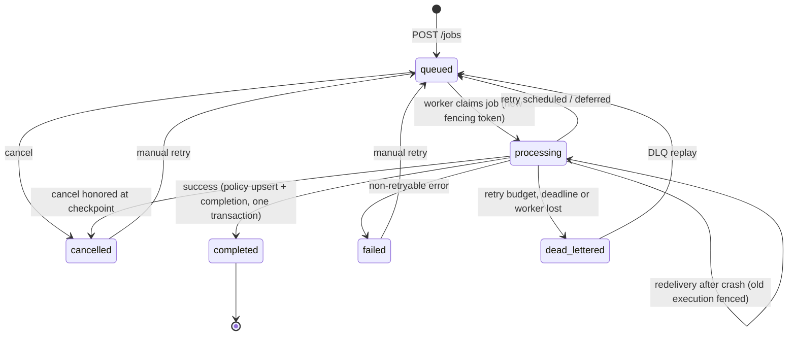

# Job state machine

The allowed transitions are encoded once in
[`src/jobs/job-states.ts`](../src/jobs/job-states.ts) and covered exhaustively by
[`test/unit/job-states.test.ts`](../test/unit/job-states.test.ts): every pair of states not
listed above is asserted to be forbidden.

## States

| State | Meaning | Terminal |
|---|---|---|
| `queued` | Durable and waiting for a worker: new, waiting out a retry delay, or deferred by the breaker/rate limiter. `next_attempt_at` is set while waiting. | No |
| `processing` | Owned by exactly one execution (`execution_id`). | No |
| `completed` | Policy retrieved, validated against NormalizedPolicy v1 and persisted. | Yes |
| `failed` | Stopped by a non-retryable error (404, 403, schema violation, other 4xx). | Yes (manual retry allowed) |
| `dead_lettered` | Transient failures could not be resolved within the budget: `attempts_exhausted`, `deadline_exceeded`, `retry_after_exceeds_limit`, or `worker_lost`. Has a `dead_letters` row. | Yes (replay allowed) |
| `cancelled` | Cancelled by an operator. | Yes (manual retry allowed) |

## How retries affect the state machine

- **Automatic retry** (transient error, attempts left): `processing → queued`. `attempts` was
  already incremented when the attempt started; `next_attempt_at` records when the next attempt
  may begin. The same BullMQ message is moved to the delayed set (`moveToDelayed`), so automatic
  retries never create new messages.
- **Deferral** (breaker open, or rate-limit wait too long): `processing → queued`. `attempts` is
  **not** incremented; `circuit_deferrals` / `rate_limit_deferrals` are. Deferrals are bounded by
  the job deadline.
- **Manual retry / replay**: `failed | dead_lettered | cancelled → queued`. Starts a new run
  (`replay_count + 1`) with a fresh attempt budget and deadline. Attempt rows keep their `run`
  number, so the history of every run is preserved.
- **Redelivery** after a crash: `processing → processing` with a new `execution_id`. Attempt rows
  left open by the lost execution are marked `abandoned`. The abandoned attempt still counts
  toward `maxAttempts`, because it may have reached the carrier.

## How cancellation affects the state machine

- From `queued`: immediate `queued → cancelled`.
- From `processing`: sets `cancel_requested`. The next checkpoint (schedule retry, defer, or a
  redelivered claim) turns it into `processing → cancelled`. A successful in-flight attempt still
  completes the job.
- From `cancelled`: idempotent (`already_cancelled`).
- From `completed`, `failed`, `dead_lettered`: `409 INVALID_STATE_TRANSITION`.

## Concurrency control

Every transition, whether from the worker, the API (`retry`, `cancel`) or the reconciler, runs
in a short transaction that starts with `SELECT … FOR UPDATE` on the job row
([`src/jobs/job-lock.ts`](../src/jobs/job-lock.ts)). Read, check and write are therefore atomic
with respect to each other. For example, "the operator cancels at the same moment the worker
schedules a retry" resolves deterministically: whichever transaction locks the row second sees
the first one's result. No transaction is ever held open across an upstream HTTP call.
